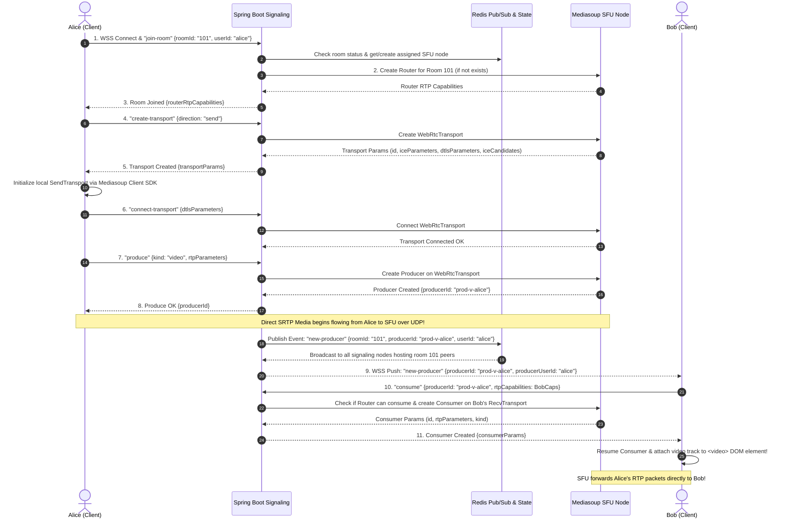
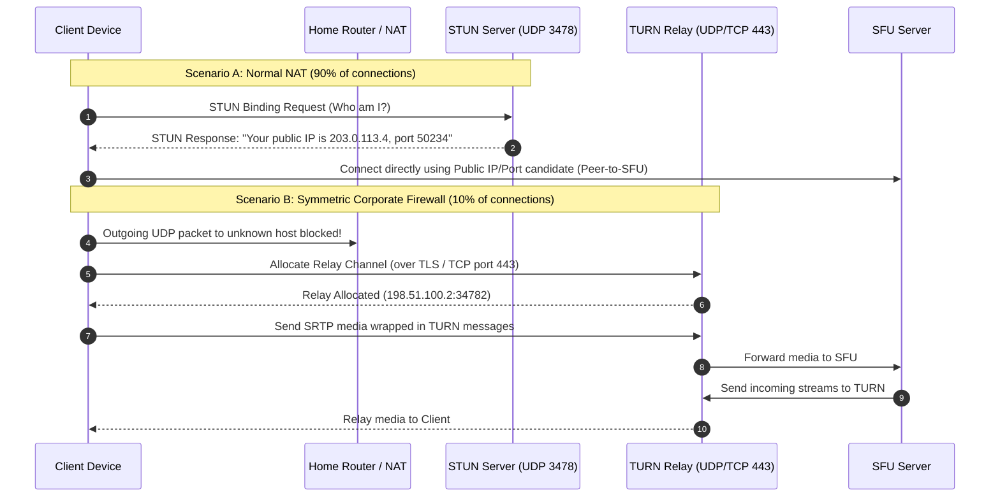
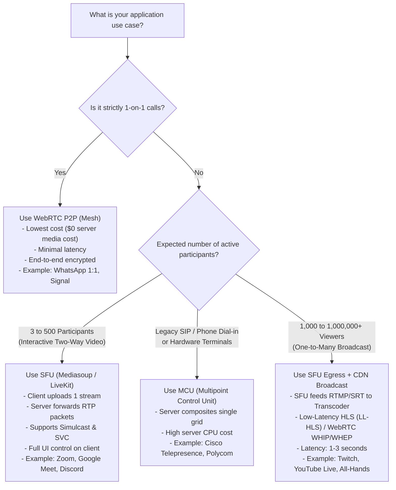

# 🎥 Real-Time Video Conferencing System Design (WebRTC, SFU & Mediasoup)

> A production-grade distributed system design covering ultra-low latency real-time communication: from raw WebRTC networking and peer-to-peer bottlenecks, to Selective Forwarding Units (SFU), Mediasoup internal architecture, multi-region scaling, and Spring Boot signaling orchestration.

---

## 📋 Table of Contents

1. [Problem Statement & Challenges](#1-problem-statement--challenges)
2. [Why WebRTC is Used (Foundational Protocols)](#2-why-webrtc-is-used-foundational-protocols)
3. [The Problem with Pure WebRTC (Mesh Topology)](#3-the-problem-with-pure-webrtc-mesh-topology)
4. [Media Topologies Compared: Mesh vs MCU vs SFU](#4-media-topologies-compared-mesh-vs-mcu-vs-sfu)
5. [Deep Dive: Mediasoup Architecture](#5-deep-dive-mediasoup-architecture)
6. [High-Level Design (HLD) of Video Conferencing Platform](#6-high-level-design-hld-of-video-conferencing-platform)
7. [End-to-End Call Flows (Signaling & Media Exchange)](#7-end-to-end-call-flows-signaling--media-exchange)
8. [Multi-Region Scaling & Cascaded SFUs (PipeTransports)](#8-multi-region-scaling--cascaded-sfus-pipetransports)
9. [NAT, Firewalls, STUN & TURN Infrastructure](#9-nat-firewalls-stun--turn-infrastructure)
10. [Bandwidth Estimation & Capacity Planning](#10-bandwidth-estimation--capacity-planning)
11. [Where and When to Use Which Architecture](#11-where-and-when-to-use-which-architecture)
12. [Role of Spring Boot in WebRTC/SFU Ecosystem](#12-role-of-spring-boot-in-webrtcsfu-ecosystem)

---

## 1. Problem Statement & Challenges

Designing a real-time multi-party video conferencing system (such as Zoom, Google Meet, or Microsoft Teams) is fundamentally different from traditional web or streaming architectures (like Netflix or YouTube).

```
┌─────────────────────────────────────────────────────────────────────────────┐
│                       HTTP Video Streaming (Netflix, YouTube)               │
│  [Source] ──> [Encode] ──> [HLS/DASH Chunks (2-6s)] ──> [CDN] ──> [Client]  │
│  Latency: 3 to 15 seconds | Protocol: TCP / HTTP | Buffer: High (smoother) │
└─────────────────────────────────────────────────────────────────────────────┘

┌─────────────────────────────────────────────────────────────────────────────┐
│                   Interactive Real-Time Conferencing (Zoom, Meet)           │
│  [Camera/Mic] ──> [Capture] ──> [SRTP Packets (<20ms)] ───────> [Recipient] │
│  Latency: < 150-200 ms    | Protocol: UDP / SRTP | Buffer: Minimal (<50ms)  │
└─────────────────────────────────────────────────────────────────────────────┘
```

### The Core Challenges:

1. **The Human Perception Barrier (< 150–200ms latency):**
   - In bi-directional conversations, if end-to-end latency exceeds **200ms**, humans begin interrupting each other ("talk-over" effect).
   - At **> 400ms**, natural conversation breaks down completely.
   - Traditional protocols like HTTP Live Streaming (HLS) or Dynamic Adaptive Streaming over HTTP (DASH) buffer 2 to 6-second video chunks over TCP. This introduces 5 to 30 seconds of latency—unacceptable for conferencing.

2. **The Pitfalls of TCP for Real-Time Media (Head-of-Line Blocking):**
   - TCP guarantees in-order delivery via acknowledgments and automatic retransmissions (ARQ).
   - If packet #3 is dropped over the internet, TCP pauses delivery of packets #4, #5, and #6 until packet #3 is re-sent and acknowledged.
   - For real-time video, an old video frame arriving 300ms late is useless junk; the client needs the newest frame immediately. Dropped packets must either be skipped or recovered via Forward Error Correction (FEC), which requires **UDP**.

3. **Fluctuating Networks & Asymmetric Bandwidth:**
   - Real-world networks suffer from packet loss (1%–10%), jitter (delay variations), and sudden bandwidth drops (e.g., switching from Wi-Fi to 4G/5G).
   - Residential connections are heavily asymmetric: download speeds may be 100–500 Mbps, but upload speeds are often capped at 10–20 Mbps.

4. **NATs and Enterprise Firewalls:**
   - Over 80% of end-user devices do not have public IP addresses. They sit behind home routers (NAT) or strict corporate firewalls that block unsolicited incoming UDP traffic.

5. **Client Hardware Constraints:**
   - Video encoding and decoding are computationally heavy. Decoding 15 simultaneous 1080p video feeds will cause a mobile device to overheat, throttle CPU, drop frames, and rapidly drain battery.

---

## 2. Why WebRTC is Used (Foundational Protocols)

**WebRTC (Web Real-Time Communication)** is an open standard created by the W3C and IETF that enables real-time peer-to-peer audio, video, and generic data transfers directly in web browsers and mobile apps without external plugins or proprietary software.

```
┌─────────────────────────────────────────────────────────────┐
│                      WebRTC Stack                           │
├─────────────────────────────────────────────────────────────┤
│  Application Layer: JavaScript APIs                         │
│  - getUserMedia() (Audio/Video Capture)                    │
│  - RTCPeerConnection (Signaling, Connection & Media)        │
│  - RTCDataChannel (Low-latency arbitrary binary data)       │
├─────────────────────────────────────────────────────────────┤
│  Media Engine:                                              │
│  - Audio Codecs: Opus (6-510 kbps, adaptive, speech/music)  │
│  - Video Codecs: VP8, VP9, AV1, H.264                       │
│  - DSP: Acoustic Echo Cancellation (AEC), AGC, Noise Red.   │
│  - Jitter Buffer & Packet Loss Concealment (PLC)            │
├─────────────────────────────────────────────────────────────┤
│  Transport & Security:                                      │
│  - SRTP (Secure Real-time Transport Protocol - Encrypted)  │
│  - DTLS (Datagram TLS - Key negotiation & Authentication)   │
│  - SCTP (Stream Control Transport Protocol - Data Channels) │
├─────────────────────────────────────────────────────────────┤
│  NAT Traversal & Network:                                   │
│  - ICE (Interactive Connectivity Establishment)             │
│  - STUN (Session Traversal Utilities for NAT)               │
│  - TURN (Traversal Using Relays around NAT)                 │
│  - UDP (User Datagram Protocol)                             │
└─────────────────────────────────────────────────────────────┘
```

### Why WebRTC is the Industry Standard:

1. **Sub-second Latency over UDP:**
   - Built on UDP with SRTP encryption. Typical glass-to-glass latency is **50ms – 150ms**.
2. **Mandatory End-to-End Encryption:**
   - WebRTC enforces DTLS-SRTP for all media and data channels. Unencrypted media cannot be transmitted.
3. **Adaptive Audio/Video Codecs:**
   - **Opus:** Dynamically scales from 6 kbps (narrowband voice) to 510 kbps (full-band stereo).
   - **VP8 / VP9 / AV1 / H.264:** Hardware-accelerated video codecs with dynamic resolution downscaling.
4. **Built-in Quality of Service (QoS) & Congestion Control:**
   - **TWCC (Transport-Wide Congestion Control):** Receiver continuously reports packet arrival times back to the sender via RTCP, allowing the sender to estimate network bottleneck capacity dynamically.
   - **NACK (Negative Acknowledgment):** Requests retransmission of only specific missing packets if time permits.
   - **PLI / FIR (Picture Loss Indication / Full Intra Request):** Requests a fresh video keyframe (I-frame) if frames are corrupted.

---

## 3. The Problem with Pure WebRTC (Mesh Topology)

Pure WebRTC was designed as a **Peer-to-Peer (P2P / Mesh)** architecture. In a 1-on-1 call (Peer A to Peer B), this is ideal: media flows directly between devices with zero intermediary server processing cost.

However, when three or more users join a room, **Pure WebRTC completely breaks down.**

### The Mesh Topology Bottleneck

In a Mesh topology, every participant must establish an independent bi-directional WebRTC connection with every other participant in the room:

```
         Mesh Topology (5 Participants)

             [Peer A]
            /   |   \
           /    |    \
     [Peer B]───┼───[Peer C]
        \ \    /    / /
         \  \ /    / /
          [Peer D]───[Peer E]

  Number of P2P Connections = N * (N - 1) / 2
  For N = 5:  5 * 4 / 2 = 10 connections
  For N = 10: 10 * 9 / 2 = 45 connections
  For N = 20: 20 * 19 / 2 = 190 connections
```

### Mathematical Analysis of Mesh Failures:

| Metric | Mesh Formula | 2 Users | 5 Users | 10 Users | 20 Users |
|:---|:---:|:---:|:---:|:---:|:---:|
| **Total Media Streams** | $N \times (N - 1)$ | 2 | 20 | 90 | 380 |
| **Client Upload Streams** | $N - 1$ | 1 | 4 | 9 | 19 |
| **Client Upload Bandwidth** (@ 1.5 Mbps) | $(N - 1) \times 1.5$ Mbps | 1.5 Mbps | 6.0 Mbps | 13.5 Mbps | 28.5 Mbps |
| **Client Download Bandwidth** (@ 1.5 Mbps) | $(N - 1) \times 1.5$ Mbps | 1.5 Mbps | 6.0 Mbps | 13.5 Mbps | 28.5 Mbps |
| **Client Video Encoders Running** | $N - 1$ | 1 | 4 | 9 | 19 |

### Why Mesh Fails in Production:
1. **Upload Bandwidth Exhaustion:** Most home and mobile uplinks cannot sustain 13.5 Mbps of continuous upload. Video immediately freezes or downsamples to an unwatchable 144p.
2. **CPU & Battery Meltdown:** Encoding 9 separate video streams concurrently pegs client CPUs at 100%, causing thermal throttling and dropped frames.
3. **No Central Moderation or Recording:** There is no centralized server to record the call, generate transcriptions, or enforce participant permissions.

---

## 4. Media Topologies Compared: Mesh vs MCU vs SFU

To solve the Mesh scalability crisis, architectures introduce an intermediary media server:

```
    MESH (Peer-to-Peer)               MCU (Multipoint Control Unit)               SFU (Selective Forwarding Unit)
    
       [Client A]                              [Client A]                               [Client A]
       /        \                              ▲        │                               ▲        │
  [Client B]──[Client C]                       │ Upload │ Mixed                         │ Upload │ Filtered
                                            Stream A    │ Stream A+B+C               Stream A    │ Streams B, C
                                               │        ▼                               │        ▼
                                          ┌──────────────────┐                     ┌──────────────────┐
                                          │    MCU SERVER    │                     │    SFU SERVER    │
                                          │ 1. Decode Video  │                     │ (RTP Packet      │
                                          │ 2. Mix Grid      │                     │  Router / Switch)│
                                          │ 3. Re-encode     │                     │ No Transcoding!  │
                                          └──────────────────┘                     └──────────────────┘
                                               ▲        │                               ▲        │
                                               │        ▼                               │        ▼
                                           [Client B] [Client C]                    [Client B] [Client C]
```

### 1. MCU (Multipoint Control Unit)
- **How it works:** Every client sends **1 stream** to the server. The MCU server completely **decodes** all incoming video frames into raw pixels, stitches them together into a single composite mosaic grid (e.g., 2x2 or 3x3), **re-encodes** the composite grid into a single video stream, and sends that single stream to everyone.
- **Advantages:** Client download bandwidth is $O(1)$ and CPU load is minimal.
- **Fatal Flaws:**
  - **Server CPU explosion:** Decoding and re-encoding $1080p$ video in real-time is extremely CPU/GPU intensive. Server bills skyrocket.
  - **Added Latency:** Transcoding adds 50ms – 120ms of delay.
  - **Zero UI Flexibility:** The server decides the grid layout. Clients cannot pin a specific speaker, resize windows, or hide participants.

### 2. SFU (Selective Forwarding Unit) — The Modern Gold Standard
- **How it works:** Every client uploads **exactly 1 stream** to the SFU server. The SFU **does NOT decode or transcode video pixels**. Instead, it acts as an intelligent, high-speed **RTP Packet Router / Switch**. It inspects RTP packet headers and selectively routes packet copies to other participants.
- **Key Features:**
  - **Simulcast Support:** Client uploads 3 quality layers (High 720p/1080p, Mid 360p, Low 180p). The SFU forwards the High layer only to the dominant speaker's tile, and Low layers for background thumbnails.
  - **Dynamic Subscription:** If a participant minimizes someone's tile or moves to another page, the SFU stops forwarding video packets for that tile completely.

### Comprehensive Comparison Matrix

| Feature | Mesh (P2P) | MCU (Multipoint Control Unit) | SFU (Selective Forwarding Unit) |
|:---|:---:|:---:|:---:|
| **Client Upload** | $(N - 1)$ streams ($O(N)$) | **1 stream ($O(1)$)** | **1 stream ($O(1)$)** |
| **Client Download** | $(N - 1)$ streams ($O(N)$) | **1 stream ($O(1)$)** | $M$ streams (Adaptive $O(M)$) |
| **Client CPU Load** | Extremely High (encodes $N-1$) | Very Low (decodes 1) | Moderate (decodes $M$ streams) |
| **Server CPU Load** | **Zero** (no server) | **Astronomical** (Decodes + Encodes) | **Very Low** (RTP packet forwarding) |
| **Added Server Latency** | 0 ms | 50 – 120 ms (Transcoding delay) | **< 5 – 15 ms** (Packet switching) |
| **Server Bandwidth** | 0 | Moderate | High (Relays raw packets) |
| **Client Layout Customization** | High | None (Server burns layout) | **Total** (Client renders DOM tiles) |
| **Simulcast / SVC Support** | No | Unnecessary | **Native** |
| **Max Practical Room Size** | 2 – 4 participants | 10 – 30 participants | **100 – 1,000+ participants** |
| **Used By** | WhatsApp 1:1, FaceTime | Legacy Polycom, Cisco Webex | **Zoom, Google Meet, Discord, Teams** |

---

## 5. Deep Dive: Mediasoup Architecture

**Mediasoup** is an ultra-high performance, minimalist WebRTC SFU library designed for Node.js and Rust. Unlike monolithic media servers (such as Kurento or older Jitsi builds), Mediasoup separates the **control plane** (Node.js/Rust) from the **data plane** (optimized C++ engine).

```
┌─────────────────────────────────────────────────────────────────────────────┐
│                       MEDIASOUP SFU NODE INSTANCE                           │
│                                                                             │
│  ┌───────────────────────────────────────────────────────────────────────┐  │
│  │         Node.js / Rust Application Layer (Control Plane)              │  │
│  │   - Room Management      - Authentication      - Participant State   │  │
│  │   - WebSocket Signaling  - REST/gRPC APIs      - Load Balancing      │  │
│  └──────────────────────────────────┬────────────────────────────────────┘  │
│                                     │ Unix Domain Sockets (IPC)             │
│                                     │ High-speed FlatBuffers binary IPC     │
│  ┌──────────────────────────────────▼────────────────────────────────────┐  │
│  │                  Mediasoup C++ Workers (Data Plane)                   │  │
│  │                                                                       │  │
│  │  ┌─────────────────────────┐           ┌─────────────────────────┐    │  │
│  │  │  Worker 1 (CPU Core 0)  │           │  Worker 2 (CPU Core 1)  │    │  │
│  │  │  ┌───────────────────┐  │           │  ┌───────────────────┐  │    │  │
│  │  │  │ Router (Room 101) │  │           │  │ Router (Room 102) │  │    │  │
│  │  │  │ ┌───────────────┐ │  │  Pipe     │  │ ┌───────────────┐ │  │    │  │
│  │  │  │ │WebRtcTransport│ │  │ Transport │  │ │WebRtcTransport│ │  │    │  │
│  │  │  │ │ - Producer A  │═╪══╪═══════════╪══╪═│ - Consumer A  │ │  │    │  │
│  │  │  │ │ - Consumer B  │ │  │           │  │ └───────────────┘ │  │    │  │
│  │  │  │ └───────────────┘ │  │           │  └───────────────────┘  │    │  │
│  │  │  └───────────────────┘  │           └─────────────────────────┘    │  │
│  │  └─────────────────────────┘                                          │  │
│  └───────────────────────────────────────────────────────────────────────┘  │
└─────────────────────────────────────────────────────────────────────────────┘
```

### Core Mediasoup Entities:

1. **`Worker`:**
   - A single-threaded **OS process written in C++** pinned to an individual physical CPU core.
   - It runs an internal `libuv` event loop to process UDP/SRTP packets at maximum throughput without being blocked by Node.js JavaScript execution or garbage collection pauses.

2. **`Router`:**
   - Equivalent to a **Virtual Meeting Room**.
   - Handles the audio and video routing among all participants assigned to that router.
   - Belongs strictly to a single `Worker`.

3. **`Transport`:**
   - Represents a network conduit between a client and the SFU:
     - **`WebRtcTransport`:** Standard ICE/DTLS/SRTP connection to a browser client (can be a `SendTransport` or a `RecvTransport`).
     - **`PlainTransport`:** Unencrypted RTP/RTCP transport used to pipe audio/video to external processes like FFmpeg or GStreamer for recording and broadcasting.
     - **`PipeTransport`:** Inter-router transport used to forward media between two different Routers on the same machine or across distinct physical servers.

4. **`Producer`:**
   - Represents an **incoming media stream** sent by a client to the SFU (e.g., Peer A's webcam, Peer A's microphone, or Peer A's screen share).
   - Created on a client's `SendTransport`.

5. **`Consumer`:**
   - Represents an **outgoing media stream** forwarded by the SFU to a client (e.g., Peer B receives Peer A's video).
   - Created on a client's `RecvTransport`.
   - Consumers can pause, resume, and dynamically select simulcast spatial/temporal layers.

---

## 6. High-Level Design (HLD) of Video Conferencing Platform

Below is the complete end-to-end production architecture of a globally distributed video conferencing system capable of handling millions of concurrent minutes.

```mermaid
flowchart TD
    subgraph Clients["1. Client Layer"]
        C1["Web Browser (React/Vue/JS SDK)"]
        C2["Mobile App (iOS/Android WebRTC)"]
        C3["Desktop App (Electron WebRTC)"]
    end

    subgraph Edge["2. Edge & Entry Infrastructure"]
        DNS["Geo-DNS / Anycast Routing"]
        LB["API Gateway & Reverse Proxy (NGINX/Envoy)"]
    end

    subgraph Signaling["3. Signaling & Control Plane"]
        SC1["Spring Boot Signaling Node 1"]
        SC2["Spring Boot Signaling Node 2"]
        SCN["Spring Boot Signaling Node N"]
        REDIS[("Redis Cluster\n- Room State & Producer Map\n- Pub/Sub Event Mesh")]
    end

    subgraph Orchestration["4. SFU Orchestrator & Allocator"]
        ORCH["SFU Room Allocator Service\n(Dispatches rooms to least loaded SFUs)"]
    end

    subgraph MediaCluster["5. Distributed SFU Media Edge Cluster"]
        subgraph SFUNode1["Mediasoup Node 1 (US-East)"]
            W1["Worker 1 (Core 0)"]
            W2["Worker 2 (Core 1)"]
            R1["Router Room 101"]
        end
        subgraph SFUNode2["Mediasoup Node 2 (EU-Central)"]
            W3["Worker 3 (Core 0)"]
            R2["Router Room 101 (Cascaded)"]
        end
        COTURN["Coturn Cluster (STUN / TURN Relay)"]
    end

    subgraph EgressPipeline["6. Egress, Recording & Broadcast"]
        REC["Recording Workers (FFmpeg / GStreamer)"]
        S3[("Object Storage (AWS S3 / GCS)")]
        CDN["Live CDN (HLS/DASH for 100k+ Viewers)"]
    end

    Clients -->|HTTPS / WSS Request| DNS
    DNS --> LB
    LB -->|WebSocket Handshake| Signaling
    Signaling <-->|Room State & Signaling Bus| REDIS
    Signaling -->|Assign SFU Instance| ORCH
    ORCH -->|Manage Routers / Transports| MediaCluster
    Clients <==>|Direct SRTP / UDP Media Streams| MediaCluster
    Clients <..>|Fallback UDP/TCP Relay| COTURN
    MediaCluster -->|PlainTransport RTP| REC
    REC -->|Save MP4 / WebM| S3
    REC -->|RTMP / HLS Push| CDN
```

### Architectural Component Responsibilities:

| Component | Technology | Primary Responsibility |
|:---|:---|:---|
| **Signaling Cluster** | Spring Boot (WebSocket) | User authentication, room admission, SDP exchange, ICE candidate relay, presence management. |
| **State & Message Fabric** | Redis Cluster | High-speed cache for room occupancy, active producers/consumers, and Redis Pub/Sub for cross-node signaling. |
| **SFU Media Nodes** | Mediasoup (C++ / Node.js) | Real-time SRTP packet routing, simulcast layer selection, audio level metering, packet loss recovery. |
| **SFU Orchestrator** | Spring Boot / Go Microservice | Monitors CPU, memory, and bandwidth of all SFU nodes; allocates rooms to optimal geographical SFUs. |
| **STUN/TURN Servers** | Coturn | Discovers public IP/ports for NAT traversal and relays traffic when symmetric enterprise firewalls block direct UDP. |
| **Egress Pipeline** | FFmpeg / GStreamer | Captures plain RTP feeds from SFU, mixes composite video, and persists MP4 recordings to S3 or outputs HLS for webinars. |

---

## 7. End-to-End Call Flows (Signaling & Media Exchange)

WebRTC does **not** specify a signaling protocol. Applications must implement their own signaling channel (typically over WebSockets) to negotiate parameters before media can flow.

### Step-by-Step Flow: Joining a Room and Publishing Media



---

## 8. Multi-Region Scaling & Cascaded SFUs (PipeTransports)

What happens when 5 participants are in New York and 5 participants are in London?
- If the SFU is located only in New York, all London participants must stream their video across the Atlantic Ocean twice (Upload to US + Download from US), causing high latency and packet loss.
- **Solution:** **Cascaded SFUs using Mediasoup `PipeTransport`.**

```
              US-East Region                                     EU-West Region
    ┌───────────────────────────────────┐               ┌───────────────────────────────────┐
    │     Mediasoup SFU (Virginia)      │               │      Mediasoup SFU (London)       │
    │                                   │               │                                   │
    │   [Producer: Alice Video]         │ PipeTransport │   [Consumer: Alice Video]         │
    │                │                  │  (Dedicated   │                │                  │
    │                ▼                  │  Inter-Cloud  │                ▼                  │
    │   ┌───────────────────────────┐   │   Backbone)   │   ┌───────────────────────────┐   │
    │   │  Router (Room 101 - US)   │═══╪═══════════════╪══>│  Router (Room 101 - EU)   │   │
    │   └─────────────┬─────────────┘   │               │   └─────────────┬─────────────┘   │
    │                 │                 │               │                 │                 │
    │                 ▼                 │               │                 ▼                 │
    │      [Consumer: Bob Video]        │               │     [Consumer: Charlie Video]     │
    └─────────────────┬─────────────────┘               └─────────────────┬─────────────────┘
                      │                                                   │
                ┌─────┴─────┐                                       ┌─────┴─────┐
                │  US Users │                                       │  EU Users │
                │Alice, Bob │                                       │Charlie,Dan│
                └───────────┘                                       └───────────┘
```

### How PipeTransports Scale Rooms:
1. **Local Ingestion:** Alice in New York sends her video to the US SFU node (5–15ms local latency).
2. **Inter-Cloud Backbone Relay:** The US SFU forwards **a single stream** of Alice's video to the London SFU over high-speed AWS/GCP private inter-region network cables via `PipeTransport`.
3. **Local Distribution:** The London SFU fans out copies of Alice's video locally to Charlie and Dan in Europe.
4. **Bandwidth Savings:** Instead of streaming across the ocean $N$ times, the video crosses the ocean **exactly once**.

---

## 9. NAT, Firewalls, STUN & TURN Infrastructure

To establish a direct UDP connection, peers and SFUs must discover their public IP and port mappings.

```
┌─────────────────────────────────────────────────────────────────────────────┐
│                      ICE (Interactive Connectivity Establishment)           │
├───────────────────────────────────┬─────────────────────────────────────────┤
│ 1. Host Candidates                │ Local private network IP (192.168.1.5)  │
│ 2. Server Reflexive (STUN)        │ Public IP/Port mapped by NAT            │
│ 3. Relay Candidates (TURN)        │ Fallback Relay Server IP (Coturn)       │
└───────────────────────────────────┴─────────────────────────────────────────┘
```



> [!IMPORTANT]
> **TURN Server Deployment Rule:** TURN relays consume heavy server bandwidth (1–3 Mbps per participant). Only use TURN as a fallback when direct STUN candidates fail to connect after an ICE candidate timeout (~5 seconds).

---

## 10. Bandwidth Estimation & Capacity Planning

Let us perform back-of-the-envelope calculations for a video conferencing platform hosting **10,000 concurrent participants** across various meeting sizes.

### 1. Per-Stream Bandwidth Profiles

| Quality Profile | Resolution | Frame Rate | Video Bitrate | Audio Bitrate (Opus) | Total Bitrate |
|:---|:---:|:---:|:---:|:---:|:---:|
| **High (Active Speaker)** | 1080p ($1920 \times 1080$) | 30 fps | 2.5 Mbps | 48 kbps | 2.55 Mbps |
| **Medium (Grid View)** | 720p ($1280 \times 720$) | 30 fps | 1.2 Mbps | 32 kbps | 1.23 Mbps |
| **Low (Thumbnail)** | 360p ($640 \times 360$) | 15 fps | 300 kbps | 24 kbps | 324 kbps |

### 2. A Typical 10-Person Meeting on an SFU with Simulcast:
- 1 Active Speaker (rendered High 1080p by 9 peers): $2.55 \text{ Mbps} \times 9 = 22.95 \text{ Mbps}$.
- 9 Passive Participants (rendered Low 360p thumbnails by 9 peers): $9 \times (324 \text{ kbps} \times 8) \approx 23.3 \text{ Mbps}$.
- **Total SFU Egress Bandwidth for 1 Room of 10:** $\approx 46 \text{ Mbps}$.

### 3. Sizing for 10,000 Concurrent Users (1,000 rooms of 10 users each):
- **Total System Egress Bandwidth:**
  $$\text{Total Bandwidth} = 1,000 \times 46 \text{ Mbps} = 46,000 \text{ Mbps} = 46 \text{ Gbps}$$
- **Mediasoup Server Instance Sizing:**
  - Standard AWS `c6i.4xlarge` (16 vCPUs, 32 GB RAM, 12.5 Gbps network interface).
  - A single 16-core Mediasoup instance comfortably forwards **~2.5 Gbps** of RTP packets before NIC or kernel interrupt saturation.
  - **Required SFU Instances:**
    $$\text{Instances Required} = \frac{46 \text{ Gbps}}{2.5 \text{ Gbps/instance}} \approx 19 \text{ instances}$$
  - With $N+1$ redundancy and $30\%$ peak headroom buffer: **Deploy 25 to 28 SFU nodes globally.**

---

## 11. Where and When to Use Which Architecture

Use this decision matrix when choosing an architecture for a new real-time communication project:



---

## 12. Role of Spring Boot in WebRTC/SFU Ecosystem

A common misconception among backend engineers is attempting to process raw WebRTC UDP packets inside a Java virtual machine.

### Why Media Processing Stays in C++ (Mediasoup) While Spring Boot Controls the Business Plane:

```
┌─────────────────────────────────────────────────────────────────────────────┐
│                    Separation of Concerns: JVM vs Native Engine             │
├──────────────────────────────────────┬──────────────────────────────────────┤
│ ❌ Why NOT Java/JVM for Media Plane: │ ✅ What Java / Spring Boot Excels At:│
├──────────────────────────────────────┼──────────────────────────────────────┤
│ • Garbage Collection pauses (Stop-   │ • Scalable, enterprise-grade         │
│   the-World GC) introduce 10-100ms   │   WebSocket connection handling.     │
│   jitter, dropping audio/video.      │ • Spring Security (JWT / OAuth2).    │
│ • High-performance UDP socket memory │ • Room state & ACL permission checks.│
│   copying in Java is less efficient  │ • SFU cluster load balancing and     │
│   than native C++ `libuv` / epoll.   │   orchestration.                     │
│ • Modern codecs (VP9, AV1, Opus) are │ • Distributed Redis Pub/Sub event    │
│   written in native C/C++ libraries. │   broadcasting across instances.     │
└──────────────────────────────────────┴──────────────────────────────────────┘
```

### The Spring Boot Architecture in this Project:

1. **Signaling Server (`SignalingWebSocketHandler`):**
   - Manages bi-directional WebSocket sessions with clients.
   - Parses incoming JSON messages (`join-room`, `leave-room`, `create-transport`, `produce`, `consume`).
2. **Room & Peer Management (`RoomService`):**
   - Thread-safe tracking of rooms, participants, active producers, and consumers.
3. **SFU Client / Orchestrator (`MediasoupOrchestrator`):**
   - Communicates with Mediasoup SFU nodes via REST/WebSocket/gRPC to trigger `createRouter`, `createWebRtcTransport`, `connectTransport`, `produce`, and `consume`.
4. **Redis Pub/Sub Sync (`RedisSignalingMessagePublisher`):**
   - Dispatches signaling events across multiple Spring Boot instances so peers on separate server nodes communicate seamlessly.

---

## 🚀 Next Steps

Explore the complete production-ready Spring Boot implementation in:
👉 [`code/real_time_conferencing/`](../../code/real_time_conferencing/)
- Detailed README and architectural overview.
- Spring Boot WebSocket signaling server.
- Full Mediasoup SFU orchestration service.
- Ready-to-run interactive HTML5 / WebRTC test client!

