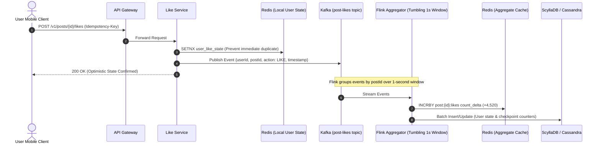

# ❤️ Social Engagement Engine — System Design (Likes, Comments & Dislikes at Hyper-Scale)

> **Platforms covered:** Instagram, Twitter (X), YouTube, TikTok  
> **Core Focus:** Handling 1M+ writes/second on viral posts, distributed sharded counters, two-level comment threading, eventual consistency, and bot/brigading protection.

---

## 📌 Table of Contents
1. [Scale & Requirements (Back-of-Envelope)](#1-scale--requirements-back-of-envelope)
2. [Core Engineering Challenges](#2-core-engineering-challenges)
3. [High-Level System Architecture](#3-high-level-system-architecture)
4. [Deep Dive: Like & Dislike Engine](#4-deep-dive-like--dislike-engine)
   - [User State vs Aggregate Counter](#41-user-state-vs-aggregate-counter)
   - [The Hotspot Problem (Celebrity Posts)](#42-the-hotspot-problem-celebrity-posts)
   - [Sharded Counters (Scatter-Gather / Striping)](#43-sharded-counters-scatter-gather--striping)
   - [Event-Driven Write-Behind Batching (Kafka + Flink)](#44-event-driven-write-behind-batching-kafka--flink)
5. [Deep Dive: Comments Service](#5-deep-dive-comments-service)
   - [Data Modeling & Threading (2-Level vs Arbitrary Depth)](#51-data-modeling--threading)
   - [Pagination at Scale (Why Offset Fails)](#52-pagination-at-scale-cursor-based)
   - [Top Comments Ranking Pipeline](#53-top-comments-ranking-pipeline)
   - [Spam & Toxicity Moderation](#54-spam--toxicity-moderation)
6. [YouTube Dislike System Special Case](#6-youtube-dislike-system-special-case)
7. [Database Schema & Data Models](#7-database-schema--data-models)
8. [Edge Cases, Idempotency & Failure Scenarios](#8-edge-cases-idempotency--failure-scenarios)
9. [Interview Summary & Cheat Sheet](#9-interview-summary--cheat-sheet)

---

## 1. Scale & Requirements (Back-of-Envelope)

### 1.1 Scale Numbers
* **Daily Active Users (DAU):** 500 Million
* **Total Posts / Videos uploaded daily:** ~100 Million
* **Total Likes / Reactions daily:** 10 Billion actions/day
  * **Average Like Writes/sec:** $\frac{10 \times 10^9}{86,400} \approx 115,000 \text{ writes/sec}$
  * **Peak Like Writes/sec (Viral events like World Cup / Super Bowl / GTA 6 trailer):** **1,000,000+ writes/sec** on a single viral entity!
* **Read-to-Write Ratio for Likes:** **100:1 to 500:1**
  * Peak Read Queries/sec: **50,000,000+ reads/sec**
* **Comments created daily:** ~1 Billion comments/day (~12,000 writes/sec average, 50,000+ writes/sec peak)

### 1.2 Functional Requirements
1. **Like / Unlike:** User can like a post/comment and undo it (toggle).
2. **Dislike / Undislike (YouTube):** User can dislike (publicly hidden count, private creator view, fed into recommendation engine).
3. **Accurate or Near-Accurate Aggregate Count:** Display total like/dislike counts (e.g., "14.2M").
4. **User Reaction State:** When User A views a post, they must immediately see whether *they* have liked it (Red heart icon).
5. **Add & View Comments:** Support nested replies (2-level hierarchy like Instagram/YouTube), cursor-based pagination, and top/newest sorting.

### 1.3 Non-Functional Requirements
1. **High Availability (99.999%):** Likes and comments must never take down the app.
2. **Ultra-Low Latency:** 
   - Write acknowledgment (Optimistic UI): `< 50ms`
   - Read latency for counts and state: `< 20ms`
3. **Eventual Consistency for Counters:** Seeing 10,500,200 vs 10,500,250 likes is acceptable for general users; however, **Read-Your-Own-Writes consistency** is mandatory for the acting user.
4. **Idempotency:** Double-taps or network retries must never corrupt counters or create duplicate rows.

---

## 2. Core Engineering Challenges

```
┌─────────────────────────────────────────────────────────────────────────────┐
│                       3 KILLER CHALLENGES AT THIS SCALE                     │
├─────────────────────────────────────────────────────────────────────────────┤
│ 1. HOT-ROW WRITE CONTENTION                                                 │
│    When 500k users click like on Messi's post at the same second:           │
│    UPDATE posts SET like_count = like_count + 1 WHERE id = 123;             │
│    causes DB deadlocks, row-lock queues, and server crash!                 │
├─────────────────────────────────────────────────────────────────────────────┤
│ 2. DUAL STATE DIVERGENCE                                                    │
│    System must store TWO completely different things:                       │
│    a) Aggregate Count: 45,000,000 (Number)                                  │
│    b) Per-User State: has_liked(user_id, post_id) = True/False (Boolean)   │
│    Syncing both at million ops/sec without race conditions is hard.        │
├─────────────────────────────────────────────────────────────────────────────┤
│ 3. TWO-LEVEL COMMENT THREADING & PAGINATION                                 │
│    Relational recursive queries (`WITH RECURSIVE`) do not scale. Offset    │
│    pagination breaks when 100 new comments are inserted every second.       │
└─────────────────────────────────────────────────────────────────────────────┘
```

---

## 3. High-Level System Architecture

```
                       ┌─────────────────────────┐
                       │   Clients (Mobile/Web)  │
                       │   (Optimistic UI Update)│
                       └────────────┬────────────┘
                                    │ HTTPS / HTTP3 / gRPC
                       ┌────────────▼────────────┐
                       │    API Gateway & WAF    │
                       │ (Rate Limiting, Auth)   │
                       └────────────┬────────────┘
                                    │
          ┌─────────────────────────┴─────────────────────────┐
          │                                                   │
┌─────────▼──────────────┐                         ┌──────────▼──────────────┐
│  Like/Reaction Service │                         │     Comments Service    │
│   (Stateless Pods)     │                         │     (Stateless Pods)    │
└─────────┬──────────────┘                         └──────────┬──────────────┘
          │                                                   │
          ├─────────────────────────────────────────┐         ├──────────────────────────┐
          │                                         │         │                          │
┌─────────▼───────────┐                 ┌───────────▼──────┐  │              ┌───────────▼───────────┐
│ Redis User State    │                 │ Apache Kafka     │  │              │ ScyllaDB / Cassandra  │
│ (Has User Liked?)   │                 │ (Reaction Topic) │  │              │ (Comments Store)      │
└─────────────────────┘                 └───────────┬──────┘  │              └───────────────────────┘
                                                    │         │
                                        ┌───────────▼──────┐  │              ┌───────────────────────┐
                                        │ Flink / Worker   │  │              │ Content Moderation    │
                                        │ (Tumbling Batch) │──┤              │ ML Service (Async)    │
                                        └───────────┬──────┘  │              └───────────────────────┘
                                                    │         │
                                        ┌───────────▼──────┐  │              ┌───────────────────────┐
                                        │ Redis Sharded    │  │              │ ElasticSearch /       │
                                        │ Counters Cache   │  │              │ Vector Ranker (Top)   │
                                        └───────────┬──────┘  │              └───────────────────────┘
                                                    │         │
                                        ┌───────────▼─────────▼──────┐
                                        │ Persistent Distributed DB  │
                                        │ (Cassandra / DynamoDB)     │
                                        └────────────────────────────┘
```

---

## 4. Deep Dive: Like & Dislike Engine

### 4.1 User State vs Aggregate Counter

Never store likes only as an incremental number, and never compute counts on the fly using `COUNT(*)` over millions of rows:
* **User Reaction State (Point Query):** Did User `U123` like Post `P999`?
* **Aggregate Counter (Analytical/Cache Value):** How many people liked `P999`?

#### Handling the User State:
1. Fast In-Memory Check: **Redis Set** or **Redis Hash** per post:
   * Key: `post:likes:state:{post_id}` -> Hash field: `{user_id}` -> Value: `1` (or timestamp).
   * For ultra-viral posts with millions of likes, a single Redis Set would exceed memory limits and create a big key problem.
   * **Solution for viral posts:** Shard the state key by user ID hash:
     ```
     Key: post:{post_id}:likes_state:{user_id % 100}
     ```
   * Or write directly to a partitioned NoSQL table (ScyllaDB / Cassandra) where Primary Key is `((post_id), user_id)`.

---

### 4.2 The Hotspot Problem (Celebrity Posts)

If Cristiano Ronaldo posts a photo, 10 million people hit "Like" within 10 minutes (~16,000 writes/sec to the same database row).
* If you run: `UPDATE posts SET like_count = like_count + 1 WHERE id = 101` in MySQL/PostgreSQL:
  * Row-level lock causes a queue of 16,000 requests per second.
  * DB connection pool exhausts in 2 seconds.
  * Whole database goes down (Cascading failure).

---

### 4.3 Sharded Counters (Scatter-Gather / Striping)

To eliminate write lock contention on a single key in Redis or SQL:
Instead of 1 counter key for Post `101`, allocate **$N$ shards (e.g., $N = 32$ or $100$)**:

```
post:101:like_shard:0  --> 12,410
post:101:like_shard:1  --> 12,390
post:101:like_shard:2  --> 12,450
...
post:101:like_shard:31 --> 12,405
```

* **On Like Write:**
  The server randomly picks a shard:
  $$\text{shard\_index} = \text{user\_id} \pmod N \quad \text{or} \quad \text{rand}(0, N-1)$$
  Execute atomic increment:
  ```bash
  INCRBY post:101:like_shard:{shard_index} 1
  ```
  Now write throughput is scaled **$N\times$** without any single key lock contention!
* **On Counter Read:**
  * Option A: Read all $N$ keys and sum them (`MGET post:101:like_shard:0 ... 31`).
  * Option B (Better): A background worker aggregates all shards every 2 to 5 seconds into a single read-cache key:
    ```
    post:101:cached_like_count = 396,655
    ```

---

### 4.4 Event-Driven Write-Behind Batching (Kafka + Flink)

At Instagram / Twitter scale, even direct Redis INCR on millions of requests puts pressure on Redis. The production-grade approach is **Write-Behind Asynchronous Ingestion**:



1. **Client receives 200 OK instantly** (in `< 30ms`).
2. **Kafka Partition Key:** Partition by `post_id`. This guarantees that all likes/unlikes for the same post land on the same Kafka partition in strict FIFO order!
3. **Flink Stream Processing:** Aggregates increments and decrements over tumbling 1-second windows:
   * If a post received `+5,200` likes and `-120` unlikes in that 1 second, Flink outputs a single aggregate delta: `+5,080`.
   * Redis and Database receive **only 1 write operation per second** instead of 5,200!

---

## 5. Deep Dive: Comments Service

### 5.1 Data Modeling & Threading

There are 3 ways to structure comment replies:
1. **Flat:** No replies (Only top-level comments).
2. **Infinite Nesting (Reddit / Hacker News style):** Replies can have replies to arbitrary depth.
3. **Two-Level Threading (Instagram / YouTube / Twitter style):**
   * Top-level comment.
   * Direct replies to that comment (grouped under the top-level parent).
   * **Why 2-level?** Cleanest mobile UI, prevents visual clutter, and drastically simplifies database querying and caching!

#### Comment Data Schema (Cassandra / ScyllaDB)

```sql
-- Top-level comments table
CREATE TABLE comments_by_post (
    post_id text,
    comment_id timeuuid,
    user_id text,
    content text,
    like_count counter,
    reply_count counter,
    created_at timestamp,
    PRIMARY KEY ((post_id), comment_id)
) WITH CLUSTERING ORDER BY (comment_id DESC);

-- Replies table (grouped by parent comment)
CREATE TABLE replies_by_comment (
    parent_comment_id timeuuid,
    reply_id timeuuid,
    user_id text,
    reply_to_user_id text,
    content text,
    like_count counter,
    created_at timestamp,
    PRIMARY KEY ((parent_comment_id), reply_id)
) WITH CLUSTERING ORDER BY (reply_id ASC);
```

* **Partition Key `(post_id)`:** All comments for a post are collocated on the same Cassandra node/shard for ultra-fast range queries.
* **Clustering Key `comment_id DESC`:** Pre-sorted chronologically on disk using `TimeUUID` (which combines timestamp and unique machine ID).

---

### 5.2 Pagination at Scale (Cursor-Based vs Offset)

#### Why `OFFSET / LIMIT` Fails:
* If User loads Page 1 (items 1–20), and 5 new comments are posted in the next 2 seconds:
* When the user requests Page 2 (`OFFSET 20 LIMIT 20`), comments that were previously on Page 1 shift into Page 2, causing duplicate items on the screen!
* In addition, `OFFSET 100000` requires scanning and discarding 100,000 rows in the storage engine.

#### Cursor-Based (Keyset) Pagination:
The cursor is simply an opaque base64-encoded tuple: `{created_at, comment_id}`.
```sql
SELECT * FROM comments_by_post
WHERE post_id = 'P101' AND comment_id < :cursor_comment_id
LIMIT 20;
```
* **Performance:** $O(\log N)$ index seek regardless of whether you are on comment 10 or comment 1,000,000!
* **Idempotent:** Never shows duplicate comments even if 1,000 new comments are inserted concurrently.

---

### 5.3 Top Comments Ranking Pipeline

Most users do not want chronological comments; they want **Top / Relevant Comments** (e.g. pinned by creator, verified users, highest likes).

```
┌──────────────────────────────────────────────────────────────┐
│                    TOP COMMENTS PIPELINE                     │
├──────────────────────────────────────────────────────────────┤
│ 1. SCORE CALCULATION FORMULA:                                │
│    Score = (w1 * Likes) + (w2 * ReplyCount)                 │
│            + (w3 * AuthorInteraction) - (w4 * ToxicityScore) │
│            - (w5 * AgeDecay)                                 │
│                                                              │
│ 2. REDIS SORTED SET (ZSET) FOR HOT POSTS:                    │
│    Key: post:{post_id}:top_comments                          │
│    Score: Floating point calculated score                    │
│    Member: comment_id                                        │
│                                                              │
│ 3. ZREVRANGEBYSCORE post:{post_id}:top_comments +inf -inf    │
│    LIMIT 0 20                                                │
└──────────────────────────────────────────────────────────────┘
```

---

### 5.4 Spam & Toxicity Moderation

Comments cannot go directly to the public feed without safety checks:
1. **Synchronous Light Checks (Regex / Blocklist / Rate Limiter):** Checks for banned words, phishing URLs, and user rate limits ($< 5\text{ms}$).
2. **Asynchronous Deep AI Moderation:**
   * Published to Kafka topic `comment-safety-check`.
   * Natural Language Processing (NLP) / BERT worker models score toxicity, harassment, and spam.
   * If flagged: Comment status changed to `HIDDEN` or `FLAGGED_FOR_REVIEW`.
   * **Shadowbanning:** Toxic users see their own comments (so they don't realize they're blocked), but no other user can see them!

---

## 6. YouTube Dislike System Special Case

In late 2021, YouTube made dislike counts private to prevent **"Dislike Brigading"** (coordinated attacks by groups targeting creators).

```
┌───────────────────────────────────────────────────────────────────────────────┐
│                     YOUTUBE DISLIKE DUAL-PIPELINE                             │
├───────────────────────────────────────────────────────────────────────────────┤
│                                                                               │
│                   ┌───────────────────────────────┐                           │
│                   │   User Clicks Dislike Button  │                           │
│                   └───────────────┬───────────────┘                           │
│                                   │                                           │
│                 ┌─────────────────┴─────────────────┐                         │
│                 │                                   │                         │
│        [PUBLIC READ PATH]                  [PRIVATE WRITE PIPELINE]           │
│                 │                                   │                         │
│     * Returns: Boolean state only                   │                         │
│       has_disliked = true                           ▼                         │
│     * Counter: HIDDEN to public           ┌───────────────────┐               │
│     * Fed into Recommendation ML Engine   │ Anti-Fraud & Bot  │               │
│       (Negative signal for watch feed)    │ Detection Service │               │
│                                           └─────────┬─────────┘               │
│                                                     │ (Validated events)      │
│                                                     ▼                         │
│                                           ┌───────────────────┐               │
│                                           │ YouTube Studio    │               │
│                                           │ Creator Analytics │               │
│                                           │ (Exact Counts)    │               │
│                                           └───────────────────┘               │
└───────────────────────────────────────────────────────────────────────────────┘
```

* **Why Dislikes are Harder than Likes:**
  * Dislikes attract heavy bot traffic and coordinated spam attacks.
  * Dislikes pass through an **Anti-Fraud Filter** (checking IP velocity, account age, video watch percentage: if a user dislikes within 1 second of opening a 20-minute video, it is filtered out as bot fraud).
  * Only creators see verified dislike counts in YouTube Studio dashboard.

---

## 7. Database Schema & Data Models

### 7.1 Reaction State Table (NoSQL - ScyllaDB / DynamoDB)
Stores individual user reactions with idempotency and quick toggles:

```sql
CREATE TABLE user_reactions (
    entity_type text,         -- 'POST', 'COMMENT', 'REEL'
    entity_id text,           -- UUID of target
    user_id text,             -- UUID of acting user
    reaction_type text,       -- 'LIKE', 'DISLIKE', 'HEART'
    created_at timestamp,
    PRIMARY KEY ((entity_type, entity_id), user_id)
);
```
* **Query:** Has User `U1` liked Post `P10`?
  ```sql
  SELECT reaction_type FROM user_reactions 
  WHERE entity_type = 'POST' AND entity_id = 'P10' AND user_id = 'U1';
  ```

---

### 7.2 Aggregated Counters Table (Wide-column Store)

```sql
CREATE TABLE entity_counters (
    entity_type text,
    entity_id text,
    likes_count bigint,
    dislikes_count bigint,
    comments_count bigint,
    shares_count bigint,
    updated_at timestamp,
    PRIMARY KEY ((entity_type, entity_id))
);
```

---

## 8. Edge Cases, Idempotency & Failure Scenarios

| Failure Scenario | Mitigation / Solution |
| :--- | :--- |
| **User rapidly clicks Like 10 times (Flapping)** | 1. Client debounce (wait 300ms after last click).<br>2. Redis `SETNX` or state toggle key with 500ms TTL.<br>3. Kafka deduplication by `(user_id, post_id)` within sliding window. |
| **Worker crashes during batch increment** | Kafka offset commit is performed **after** the batch is written to Redis and DB (At-Least-Once delivery + Idempotent updates). |
| **Redis Cache Eviction of Counts** | Lazy reload from Cassandra `entity_counters` on cache miss using a distributed lock (to prevent Dogpiling / Thundering Herd). |
| **Network Failure during Comment Submission** | Client sends a unique `client_comment_id` (Idempotency Key). Backend rejects duplicates if the ID already exists in the cache/DB within a 24-hour window. |

---

## 9. Interview Summary & Cheat Sheet

When presenting this in a System Design Interview, follow this 6-step roadmap:

1. **Clarify Scope:**
   * "Are we designing both aggregate counts and user-specific state?" *(Yes, both)*.
   * "Is comment hierarchy 2-level or arbitrary nesting?" *(State that Instagram/YouTube use 2-level, which scales predictably)*.
2. **Acknowledge the Hotspot Problem Early:**
   * Mention: "A single row update in SQL will fail at 100k writes/sec. We will use **Sharded Counters** and **Kafka + Flink Batching**."
3. **Separate Read Path from Write Path (CQRS):**
   * Write path is asynchronous and batched via Kafka.
   * Read path is served exclusively from CDN + Redis caches.
4. **Choose the Right DB:**
   * Explain why NoSQL (ScyllaDB / Cassandra / DynamoDB) is superior to RDBMS here due to write throughput and horizontal partitioning by `entity_id`.
5. **Address User Perception:**
   * Explain **Optimistic UI Updates** and **Read-Your-Own-Writes Consistency**.
6. **Bonus Points:**
   * Mention **YouTube's Dislike Anti-Brigading fraud engine**, **Shadowbanning toxic comments**, and **Keyset pagination**.
